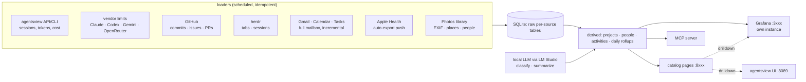

# life-metrics

A personal data warehouse and dashboard for analyzing my life and work in
retirement. Starts with work (how I use AI services and local AI, what
projects I'm working on and how) and broadens over time to health, social
connections, fun, and money. Living document; the [decisions log](#decisions-log)
at the bottom records what was settled when.

## Problem

My life generates data in a dozen silos: AI coding sessions in agentsview,
usage limits in each vendor's app, commits and issues on GitHub, email and
calendar in Google, health telemetry on Apple devices, photos on an SSD,
finances in a spreadsheet. Each silo shows only its own slice. Nothing lets
me ask cross-cutting questions ("what did I actually work on this month, and
with which tools?", "am I getting my money's worth from five AI
subscriptions?", "how much outdoor time did I get while that project was
consuming me?") or notice trends I didn't think to look for.

## Today

- **AI usage**: [agentsview][agentsview] v0.45 runs as a LaunchDaemon on
  `:8089` with ~1,500 sessions across ~30 projects (datatalk dominates).
  LM Studio completions are backfilled into it as synthetic pi sessions by
  `sef-dotfiles/bin/lmstudio-usage-sync`. [llm-use-charts][luc] is a small
  standalone site (Models / Projects stacked bars) that shells out to the
  agentsview CLI; it will be absorbed into this project.
- **Limits**: visible only in each vendor's app. No history.
- **Email / calendar**: Gmail and Google Calendar in the browser. Periodic
  Google Takeout dumps sit on the Synology as backup only, not in a
  referencable state. Synology CloudSync mirrors all of Google Drive to
  `/Cloud/Google`.
- **Health**: Apple Watch / iPhone, viewed only in the Health app.
- **Photos**: Photos library on the external SSD (`/Volumes/ext1`).
- **Prior pattern**: [homepower][homepower] is a Django + SQLite app with an
  opinionated "catalog" of question-shaped pages that deep-link into Grafana
  for detail. This project copies that shape.

## Proposal

One Django process on `studio`, run by launchd, with its own SQLite
database. Loaders pull from each source on a schedule (mostly daily; some
sources hourly) into local tables, Dogsheep-style: one loader per source,
raw data kept, derived tables rebuilt from it. A catalog of question-shaped
pages is the front door; a dedicated Grafana instance provides drilldowns;
an MCP server exposes the same data to Claude and other agents so the
dashboard is not the only way to ask questions.

### Principles

1. **Own the data, in SQLite.** Every source lands in this project's
   database. agentsview and Grafana are installed packages; we never modify
   their code or read their databases directly. Integration is via their
   APIs or CLIs. One file, backed up like homepower's.
2. **Dogsheep model.** One loader per source, raw rows preserved, derived
   tables rebuilt from raw. Reuse existing `*-to-sqlite` tools (Simon
   Willison's [dogsheep][dogsheep], karlicoss's [HPI][hpi]) where they fit,
   wrap them in management commands where they don't.
3. **Loaders are idempotent and incremental.** Re-running a loader never
   duplicates rows. Gaps are unknown, not zero (homepower's rule).
4. **Catalog first, then charts.** Each page answers a stated question.
   Grafana is for exploring; the catalog is for noticing.
5. **Also an API.** An MCP server over the same tables, so questions can be
   asked in conversation. Borrowed from [Edi Life OS][edi]; its stack
   (PHP/MySQL/Docker) is not.
6. **Local LLM by default.** Classification and summarization run through
   LM Studio. Paid APIs only when deliberately chosen. A full mailbox is in
   scope, so this is a privacy rule, not only a cost rule.
7. **Same operational shape as homepower and wrgpt-buddy.** Python, Django,
   uv, gunicorn, system LaunchDaemon `com.sefk.life-metrics`, `tailscale
   serve`, a share in local-redirector. No Docker.

### Tabs (the eventual shape of the home page)

Sketched now, filled in over time:

| Tab | Covers | Phase |
|-----|--------|-------|
| Work | Peninsula School board, datatalk; AI tool usage and subscriptions | 1 |
| Personal projects | Home stuff; technical things (backups, this, homepower) | 1 (coding projects only) |
| Health | Physical: gym, outdoor time, Apple telemetry. Intellectual: books read | 2 |
| Social | Keeping up with my network of friends (email, calendar, photos) | 3 |
| Fun | Poker (WRGPT), games, trips | 3 |
| Money | Financial plan, iterated over time | later |

## Phase 1: work and AI usage

Questions to answer:

- **What have I been working on, and how?** Per project: sessions, hours,
  tokens, cost, agents and models used, time of day, session length,
  commits, issues, PRs, herdr tabs. "Project" means a directory in `~/src`,
  optionally mapped to the friendlier names in `local-redirector/shares.toml`.
  A mapping table (not code) rolls projects up into tabs.
- **Am I making good use of my AI subscriptions?** Not one number; a set of
  explorable graphs covering both usage and limits:
  - usage over time by vendor, model, agent, project
  - estimated API-equivalent dollars vs. subscription price per month
  - consumption against each plan's rate limits (session, weekly) over time
  - local vs. paid model share, and how it shifts when the new machine lands

Subscriptions in scope, with monthly prices entered by hand in a table:

| Service | Price | Use |
|---------|-------|-----|
| Claude (Max) | $100 | primary coding driver |
| Codex | $20 | reviews; candidate for more primary work |
| Gemini AI Pro | $50 | chat only, shared with family |
| OpenRouter | pay-as-you-go | experimentation; wrgpt-buddy analyses |
| LM Studio | local | growing, especially after the new computer arrives |

Sources and loaders for phase 1:

| Source | How | Cadence |
|--------|-----|---------|
| agentsview | HTTP API on `:8089` or `agentsview ... --format json`; sessions, per-session usage | hourly |
| Claude limits | same internal endpoint claude-monitor polls, via Claude Code's keychain OAuth token | hourly |
| Codex / Gemini / OpenRouter limits | to be investigated per vendor; OpenRouter has a credits API | hourly where possible |
| LM Studio | server logs (already parsed by `lmstudio-usage-sync`); reuse or import its output | hourly |
| GitHub | `gh` or REST: commits, issues, PRs across sefk and biglocalnews repos | daily |
| herdr | its own state files or CLI; tab open/close, which project | daily |
| local git | `git log` across `~/src` for repos with no remote | daily |

Deliverables:

1. Repo skeleton: Django project, uv, SQLite, `manage.py` loaders, tests.
2. agentsview loader and the first catalog page: projects × time with
   drilldown links to agentsview sessions.
3. Subscription usage page absorbing llm-use-charts, plus a limits history
   page.
4. Grafana instance with provisioned datasource and a first dashboard.
5. Deployment: LaunchDaemon, local-redirector share, backup job.
6. MCP server exposing project and usage queries.

## Phase 2: email, calendar, and health

**Gmail / Calendar / Tasks.** Slurp the whole mailbox locally, as both a
backup and an analyzable corpus. Approach: Gmail API with the `readonly`
scope via a Desktop OAuth client (the wrgpt-buddy pattern), history-id based
incremental sync, raw RFC 822 messages stored on `/Volumes/ext1` with
metadata and parsed fields in SQLite. Initial backfill may instead come from
a fresh Takeout mbox if the API is too slow for the full history; decide
after measuring. Calendar and Tasks via their APIs, full history. Then:
summarization, correspondence stats, classification of threads and events
into tabs by a local model, Peninsula School board activity extracted from
the same mailbox.

**Apple Health.** Must be automatic; no manual exports. Recommended path:
the [Health Auto Export][hae] iOS app, which can push JSON of selected
metrics to a REST endpoint on a schedule. This app receives it on a
Tailscale-only URL. Alternatives to evaluate if that disappoints: an iOS
Shortcut automation, or an Apple Health to SQLite importer run against a
one-time export for the historical backfill. Metrics of interest: workouts
(gym), time outdoors / daylight, steps, sleep, heart rate and HRV.

**Books.** Source TBD: Kindle, Libby, Goodreads export, or a hand-kept
list.

## Phase 3 and beyond

- **Social**: who I'm in contact with, how often, trending down (people I'm
  losing touch with). Derived from email, calendar, and photo faces.
- **Fun**: WRGPT hands (from wrgpt-buddy), games, trips from calendar and
  photo locations.
- **Photos**: the library on `/Volumes/ext1` is fair game: EXIF dates and
  places, Photos' own people and albums.
- **Money**: load the financial plan and iterate on it.
- **Projects beyond code**: a home-improvement project with spending,
  milestones, contracts and correspondence. The project model must not
  assume a git repo.
- Possibly subsume local-redirector's role as the house front page.

## Storage

- SQLite database in the repo's `var/`, backed up like homepower's.
- Bulk raw data (email bodies and attachments, health exports) on
  `/Volumes/ext1/life-metrics/` (1.8 TB, ~900 GB free).
- Synology for large cold storage if needed; it's slow. Its
  `/Cloud/Google` Drive mirror is available as a read-only source.

## Operations

- `studio`, system LaunchDaemon `com.sefk.life-metrics` (web) plus a
  scheduled loader job. Ports to be assigned, avoiding the ones in
  `local-redirector/shares.toml`.
- Grafana: a second instance with its own config and `var/`, same binary as
  homepower's. Config and provisioning only, no software changes.
- Front door: `tailscale serve` and a local-redirector share
  (`life.kloninger.com` or similar).
- Cadence: most loaders daily; AI-usage loaders hourly. The dashboard is
  meant to be consulted several times a day, so pages must be cheap to
  render from precomputed rollups.

## Prior art

- [Dogsheep][dogsheep] and the [Personal Data Warehouses][pdw] talk: the
  model for this project. `google-takeout-to-sqlite`, `healthkit-to-sqlite`,
  `github-to-sqlite` are candidates for direct reuse.
- [HPI][hpi]: Python personal data importers; ideas for incremental exports.
- [LifeGraph][lifegraph]: Garmin, GitHub, mood, sleep into insights.
- [Edi Life OS][edi]: self-hosted life dashboard with an MCP server.
- [claude-monitor][cm]: how to read Claude subscription limits.
- [Claude Code ROI guide][roi]: OpenTelemetry alternative for usage data.
- Exist.io and Gyroscope: commercial references for which correlations
  are worth surfacing.

## Open questions

- Which ports for the app and its Grafana.
- Whether Codex and Gemini expose any limit data programmatically.
- API vs. Takeout for the initial Gmail backfill.
- GitHub repo: create `sefk/life-metrics` now or after the skeleton.
- Books source.

## Decisions log

**2026-10-31**

- Own SQLite database here; agentsview and Grafana stay untouched installed
  packages, integrated via API/CLI, not at the data layer.
- Phase 1 projects are coding projects as named in `~/src`, with
  local-redirector's friendly names where they exist. Project definition
  will broaden later (offline projects with spending and correspondence).
- Subscription metrics are a set of explorable usage-and-limits graphs,
  not one score. Subscriptions: Claude $100, Codex $20, Gemini $50 (shared
  with family), OpenRouter PAYG, LM Studio local.
- GitHub and herdr stats are in scope for correlation.
- Full Gmail, Calendar and Tasks mirror locally, as backup and corpus.
  Raw storage on `/Volumes/ext1`; Synology available for cold storage.
- Photos library on `/Volumes/ext1` is fair game.
- Local LLM analysis via LM Studio; start now, improve when the new machine
  arrives (qwen3.8-flash-next).
- Same stack as homepower / wrgpt-buddy. Separate Grafana instance.
- Apple Health must be automatic; no manual dumps. Recommendation: Health
  Auto Export pushing to an endpoint.
- Dashboard consulted several times daily; loaders mostly daily.
- Absorb llm-use-charts into this project.
- Borrow the MCP-server idea from Edi Life OS, not its stack.

[agentsview]: https://github.com/agentsview
[luc]: ../../../llm-use-charts
[homepower]: ../../../homepower
[dogsheep]: https://dogsheep.github.io/
[pdw]: https://simonwillison.net/2020/Nov/14/personal-data-warehouses/
[hpi]: https://github.com/karlicoss/HPI
[lifegraph]: https://github.com/Evermaple/life-graph
[edi]: https://zeli.app/story/50014150
[cm]: https://github.com/rjwalters/claude-monitor
[roi]: https://github.com/sefk/claude-code-monitoring-guide
[hae]: https://www.healthyapps.dev/
